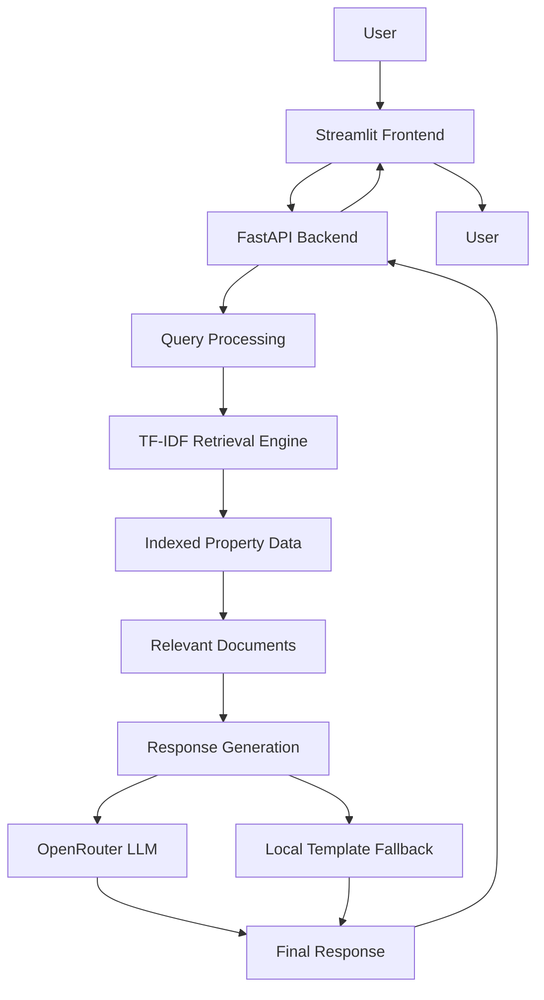

# EstateIQ – Real Estate Intelligence Platform

**Discover properties smarter. Make informed real estate decisions.**

EstateIQ is an AI-powered real estate intelligence platform that enables users to explore property information, discover real estate developments, and retrieve relevant property details through natural-language conversations.

The platform combines structured real estate data, lightweight information retrieval, and LLM-powered response generation to provide context-aware answers with source references.

<p align="center">

**Live Application:** https://estateiq-property-assistant.streamlit.app/

**Backend API:** https://estateiq-backend-u2fg.onrender.com

**GitHub Repository:** https://github.com/ADITI9981/EstateIQ

</p>

---

## 1. Project Overview

Finding relevant property information often requires navigating multiple real estate platforms, reviewing individual listings, and comparing property details manually.

EstateIQ addresses this problem through a conversational interface where users can ask questions about available properties, locations, rental prices, property features, and real estate developments.

The platform currently works with publicly available sample information collected from:

- **DarGlobal:** Real estate developments and project information.
- **Wasalt:** Property listing information and rental details.

The collected information is structured, indexed, retrieved according to user queries, and used to generate grounded responses.

## 2. Key Features

### Property Discovery
- Retrieve available property information.
- Explore property locations and configurations.
- Find details such as bedrooms, bathrooms, area, and orientation.
- Retrieve rental prices and payment alternatives when available.

### Real Estate Project Discovery
- Search DarGlobal developments.
- Retrieve project information from the available dataset.
- Identify missing or unavailable project details rather than inventing specifications.

### Conversational AI Assistant
- Natural-language question answering.
- Context-aware retrieval.
- LLM-powered response generation through OpenRouter.
- Local template-based fallback when the LLM service is unavailable.

### Source Transparency
- Display original source links.
- Provide references for retrieved information.
- Include disclaimers regarding changing property prices and availability.

## 3. Technology Stack

| Component | Technology |
|---|---|
| Programming language | Python 3.12 |
| Frontend | Streamlit |
| Backend | FastAPI |
| API server | Uvicorn |
| Retrieval | Scikit-learn TF-IDF |
| Similarity calculation | Cosine Similarity |
| Data processing | Pandas, NumPy |
| LLM integration | OpenRouter |
| API communication | Requests |
| Data serialization | JSON, Joblib, SciPy sparse matrices |
| Containerization | Docker |
| Multi-container orchestration | Docker Compose |
| Backend deployment | Render |
| Frontend deployment | Streamlit Community Cloud |
| Version control | Git and GitHub |

## 4. System Architecture

EstateIQ follows a modular architecture that separates the user interface, backend API, data ingestion, information retrieval, and response generation.



### Architecture Workflow

1. The user enters a natural-language question through the Streamlit interface.
2. The frontend sends the question to the FastAPI `/chat` endpoint.
3. The backend processes the query and applies relevant retrieval filters.
4. The TF-IDF retrieval engine identifies relevant documents.
5. Retrieved information is passed to the response-generation component.
6. OpenRouter is used when an API key and available model service are accessible.
7. If the LLM service is unavailable, a local template-based fallback generates a response.
8. The backend returns the answer and relevant source URLs.
9. The frontend displays the response to the user.

## 5. Data Collection and Processing

EstateIQ uses publicly available information from DarGlobal and Wasalt.

### Data Sources

| Source | Information collected |
|---|---|
| DarGlobal | Selected real estate project information |
| Wasalt | Sample residential property listing information |

### Data Processing Pipeline

The data pipeline consists of:

1. Collecting publicly accessible source information.
2. Extracting relevant property and project attributes.
3. Structuring the information into JSON records.
4. Loading and processing the collected records.
5. Converting the documents into searchable TF-IDF representations.
6. Saving the retrieval index and associated metadata.

### Current Sample Dataset

The development dataset contains seven structured documents:

- Six DarGlobal project records.
- One Wasalt property listing.

The dataset is a limited development and evaluation sample. It should not be interpreted as a complete representation of either platform's inventory.

**Data collection considerations:**

- Source attribution is maintained.
- Personal contact information is not included in the sample.
- Property prices and availability may change.
- DarGlobal project information is limited to details supported by available public source material.
- Data access and permitted reuse must follow the respective source websites' terms and policies.

## 6. Information Retrieval

EstateIQ uses a lightweight TF-IDF-based retrieval architecture.

The initial heavy embedding-based approach was replaced with TF-IDF to reduce memory requirements and improve compatibility with resource-constrained deployment environments.

### TF-IDF Configuration

The retrieval engine uses:

- Character-based word-boundary analysis (`char_wb`).
- N-gram range: 2–5.
- Maximum features: 100,000.
- Minimum document frequency: 1.
- Sublinear term frequency enabled.
- Float32 feature representation.

### Retrieval Process

1. Receive the user query.
2. Identify relevant source and property/project filters.
3. Check for exact title matches.
4. Transform the query using the fitted TF-IDF vectorizer.
5. Calculate cosine similarity against indexed documents.
6. Retrieve relevant records.
7. Pass retrieved information to response generation.

### Why TF-IDF?

TF-IDF provides a lightweight, explainable retrieval approach that is suitable for a small structured dataset.

Its advantages include:

- Lower memory requirements than large embedding models.
- No GPU requirement for indexing or retrieval.
- Fast indexing and search for a small dataset.
- Straightforward deployment.
- No dependency on an external embedding API.

**Current limitation:** TF-IDF is lexical retrieval rather than semantic embedding-based retrieval. It may not understand every paraphrase or complex relationship between concepts.

## 7. LLM Integration and Fallback Mechanism

EstateIQ integrates OpenRouter using an OpenAI-compatible API interface.

### LLM Configuration

- Provider: OpenRouter
- Default model identifier: `openrouter/free`
- API key: Configured through an environment variable.
- API communication: OpenAI-compatible client.

The model is used to generate responses using retrieved context.

### Local Fallback

To improve application availability, EstateIQ includes a local template-based response mechanism.

When the LLM API key is unavailable, the provider returns an error, or the response cannot be generated, the application can use the local fallback.

The fallback uses retrieved document information to construct structured responses.

**Important:** The fallback is template-based response generation, not a second generative AI model.

## 8. Backend API Documentation

The backend is developed using FastAPI.

**Base URL:**

`https://estateiq-backend-u2fg.onrender.com`

### Available Endpoints

| Method | Endpoint | Description |
|---|---|---|
| GET | `/` | Backend root endpoint |
| GET | `/health` | Service health check |
| POST | `/chat` | Submit a chatbot question |

### Health Check

Request:

```http
GET /health
```

Example response:

```json
{
  "status": "healthy",
  "service": "EstateIQ"
}
```

### Chat Endpoint

Request:

```http
POST /chat
Content-Type: application/json
```

Request body:

```json
{
  "question": "Tell me about DG1 by DarGlobal"
}
```

Example response structure:

```json
{
  "question": "Tell me about DG1 by DarGlobal",
  "answer": "DG1 is a residential development project by DarGlobal...",
  "sources": [
    "https://darglobal.co.uk/projects/properties-in-uae"
  ]
}
```

The answer and source URLs depend on the retrieved documents and response-generation mechanism.

### API Validation

The chat endpoint validates the question:

- Minimum length: 3 characters.
- Maximum length: 1,000 characters.

Errors are handled through HTTP responses, including service-unavailable responses when backend processing fails.

Interactive API documentation is available at:

https://estateiq-backend-u2fg.onrender.com/docs

## 9. Project Structure

The repository is organized into separate frontend, backend, data, and testing components.

```text
EstateIQ/
│
├── backend/
│   ├── main.py
│   ├── ingest.py
│   ├── indexer.py
│   ├── retriever.py
│   └── llm.py
│
├── frontend/
│   └── app.py
│
├── data/
│   └── raw/
│       ├── darglobal_projects.json
│       ├── darglobal_additional_projects.json
│       └── wasalt_sample_property.json
│
├── tests/
│   └── test_api.py
│
├── Dockerfile
├── docker-compose.yml
├── requirements-docker.txt
├── .env.example
├── .gitignore
└── README.md
```

The structure above describes the main application components. Refer to the repository for the complete current file list.

## 10. Local Installation and Setup

### Prerequisites

Install the following:

- Python 3.12
- Git
- Docker Desktop (for containerized execution)

### Step 1: Clone the repository

```bash
git clone https://github.com/ADITI9981/EstateIQ.git
cd EstateIQ
```

### Step 2: Create a virtual environment

Windows PowerShell:

```powershell
python -m venv venv
.\venv\Scripts\Activate.ps1
```

### Step 3: Install dependencies

```bash
pip install -r requirements-docker.txt
```

### Step 4: Configure environment variables

Create a `.env` file in the project root.

Example:

```env
OPENROUTER_API_KEY=your_openrouter_api_key
OPENROUTER_MODEL=openrouter/free
```

Never commit your actual API key or `.env` file to GitHub.

### Step 5: Build the retrieval index

```bash
python -m backend.ingest
python -m backend.indexer
```

### Step 6: Start the backend

```bash
uvicorn backend.main:app --host 0.0.0.0 --port 8000
```

Backend:

`http://localhost:8000`

API documentation:

`http://localhost:8000/docs`

### Step 7: Start the frontend

Open another terminal, activate the virtual environment, and run:

```powershell
$env:ESTATEIQ_API_URL="http://localhost:8000/chat"
streamlit run frontend/app.py --server.port 8501
```

Frontend:

`http://localhost:8501`

## 11. Docker Deployment

EstateIQ supports containerized execution using Docker and Docker Compose.

### Build and Start

```bash
docker compose up --build -d
```

### View Running Containers

```bash
docker compose ps
```

### View Logs

```bash
docker compose logs -f
```

### Stop Services

```bash
docker compose down
```

The Docker configuration separates the backend API service from the Streamlit frontend service.

The backend builds and initializes its retrieval index during container startup.

## 12. Cloud Deployment

EstateIQ is publicly deployed using two hosting services.

### Backend – Render

- Service type: Web Service
- Runtime: Docker
- Application: FastAPI
- Health endpoint: `/health`

Backend URL:

https://estateiq-backend-u2fg.onrender.com

### Frontend – Streamlit Community Cloud

- Application framework: Streamlit
- Main file: `frontend/app.py`
- Backend connection: Render API URL

Live application:

https://estateiq-property-assistant.streamlit.app/

### Environment Configuration

The frontend requires the backend API endpoint:

```text
ESTATEIQ_API_URL=https://estateiq-backend-u2fg.onrender.com/chat
```

The backend requires its OpenRouter configuration through environment variables.

Actual credentials must be stored securely in the relevant hosting service configuration and must never be committed to the repository.

## 13. Testing and Validation

The project includes backend API tests.

Run the tests using:

```bash
python -m pytest tests/test_api.py -v
```

The development verification included:

- Backend health endpoint.
- Chat API response.
- DarGlobal project retrieval.
- Wasalt property retrieval.
- Exact project title matching.
- Source URL extraction.
- Local fallback response generation.
- Docker image build.
- Local container execution.
- Public frontend and backend deployment.

The backend API test suite passed four tests during development.

## 14. Example Queries

Users can ask questions such as:

**Property Discovery**

- Show me the available properties and their details.
- Find a nine-bedroom villa in Riyadh.
- What is the rental price of the An-Narjis villa?
- What payment options are available?

**Project Discovery**

- Tell me about DG1 by DarGlobal.
- Show me DarGlobal projects.
- Tell me about Urban Oasis.

The chatbot responds using information available in the current indexed dataset.

## 15. Limitations and Future Improvements

### Current Limitations

1. The current dataset contains a limited number of sample records.
2. Property prices and availability are not updated continuously.
3. TF-IDF retrieval may not handle complex semantic queries as effectively as embedding-based retrieval.
4. Some DarGlobal project details are not available in the collected source data.
5. OpenRouter availability and free-model quotas may affect LLM response generation.
6. The local fallback provides structured template-based responses rather than full generative reasoning.
7. The current application is a prototype and is not intended to replace official property listings or transaction services.

### Future Scope

- Expand the dataset through permitted data sources.
- Introduce scheduled data refresh and validation.
- Add semantic embedding-based retrieval.
- Implement property comparison and filtering.
- Add more advanced conversational context management.
- Introduce user feedback and answer evaluation.
- Add monitoring, logging, and performance analytics.
- Improve multilingual property discovery.
- Introduce authentication and production-grade access controls where required.

## 16. Security and Responsible Data Usage

- API keys are configured through environment variables.
- Sensitive credentials are excluded from version control.
- Public source references are included with retrieved information.
- Personal contact details are excluded from the sample dataset.
- Source-specific access and reuse conditions must be respected.
- Users should verify current prices and availability directly with the original source.

## 17. Author

**Aditi Yadav**

AI/ML | Python | Backend Development | Data Science

- GitHub: https://github.com/ADITI9981
- LinkedIn: https://www.linkedin.com/in/aditi-yadav9981/
- Portfolio: https://my-portfolio-six-ebon-14.vercel.app/

---

## Project Summary

EstateIQ demonstrates the development and deployment of a real-estate intelligence application combining structured data ingestion, lightweight information retrieval, LLM integration, REST API development, and cloud deployment.

The project brings together AI/ML concepts and backend engineering to provide a practical conversational interface for real estate information discovery.

**Live Demo:** https://estateiq-property-assistant.streamlit.app/

**Repository:** https://github.com/ADITI9981/EstateIQ
